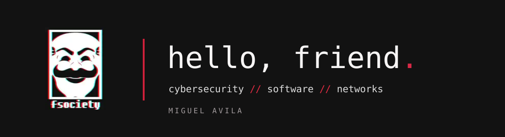

 

**MIGUEL LOCATELLI ÁVILA**  
`cybersecurity` &nbsp;·&nbsp; `software development` &nbsp;·&nbsp; `networks`

 

### ／ ABOUT

Desenvolvedor e entusiasta de **cibersegurança**, interessado em construir software confiável, compreender sistemas e explorar redes e segurança de aplicações.

Português (nativo) · Inglês C2 — [EF SET 87/100](https://cert.efset.org/pt/drbfYm)

---

### ／ STACK

&nbsp;&nbsp;&nbsp;
&nbsp;&nbsp;&nbsp;
&nbsp;&nbsp;&nbsp;
&nbsp;&nbsp;&nbsp;
&nbsp;&nbsp;&nbsp;
&nbsp;&nbsp;&nbsp;
&nbsp;&nbsp;&nbsp;
&nbsp;&nbsp;&nbsp;

  

`Python` · `JavaScript` · `TypeScript` · `HTML / CSS` · `PostgreSQL` · `Linux` · `Git`  
`Kali Linux` · `Nmap` · `Wireshark` · `Burp Suite`

---

### ／ CONTACT

