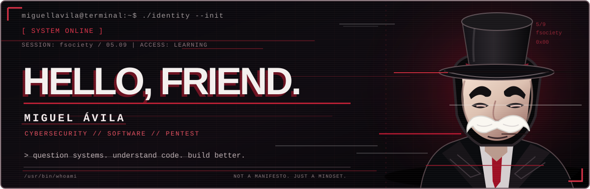
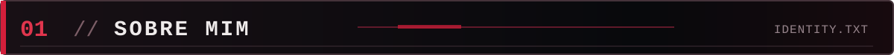
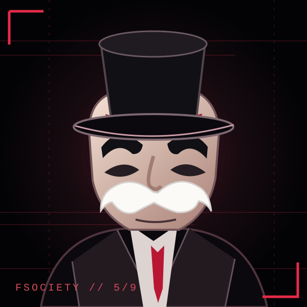
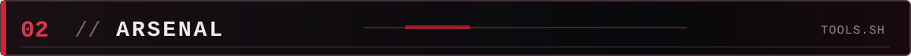
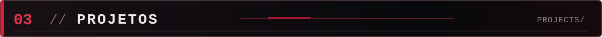
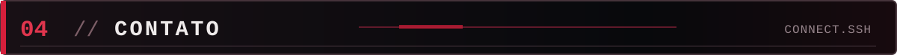

<div align="center">



<br />

`root@miguellavila:~$ whoami`

<br /><br />

**MIGUEL LOCATELLI ÁVILA**  
`CYBERSECURITY` · `SOFTWARE DEVELOPMENT` · `NETWORKS`

<br />

<a href="https://www.linkedin.com/in/miguellocatelliavila/"></a>
<a href="mailto:miglocatelliavila@gmail.com"></a>
<a href="https://github.com/miguellavila?tab=repositories"></a>

</div>

<br />



<table>
<tr>
<td width="225" align="center" valign="middle">

</td>
<td valign="middle">

```bash
miguel@localhost:~$ cat about.txt
> aprendendo, construindo, testando.
```

Sou **Miguel Ávila**, estudante e desenvolvedor com foco em **cibersegurança, redes e desenvolvimento de software**. Gosto de compreender como sistemas funcionam, identificar riscos em ambientes autorizados e transformar ideias em ferramentas práticas.

Exploro **segurança de aplicações, análise de logs, automação, redes e testes de intrusão éticos**. Meus projetos unem curiosidade técnica, documentação e evolução contínua.

**Idiomas:** português (nativo) e inglês **C2** — [EF SET 87/100](https://cert.efset.org/pt/drbfYm).

</td>
</tr>
</table>

<br />



<div align="center">

<br />


&nbsp;&nbsp;

&nbsp;&nbsp;

&nbsp;&nbsp;

&nbsp;&nbsp;

&nbsp;&nbsp;

&nbsp;&nbsp;

&nbsp;&nbsp;

&nbsp;&nbsp;

&nbsp;&nbsp;

&nbsp;&nbsp;


<br /><br />

`python` `javascript` `typescript` `html/css` `react` `postgresql` `git` `linux`  
`kali linux` `nmap` `wireshark` `burp suite` `docker`

<br />

> `Tools are not the point. Understanding the system is.`

</div>

<br />



<table>
<tr>
<td width="50%" valign="top">

### [`01 // PentestFlow`](https://github.com/miguellavila/pentestflow)

**Organização de pentests autorizados**

Aplicação local para gerenciar projetos, evidências, vulnerabilidades, atividades e relatórios técnicos em HTML/PDF.

`HTML` `CSS` `JavaScript` · **Público**

</td>
<td width="50%" valign="top">

### [`02 // HeaderGuard`](https://github.com/miguellavila/headerguard-js)

**Auditoria de cabeçalhos HTTP**

Ferramenta CLI em Node.js para inspecionar cabeçalhos de segurança e gerar relatórios JSON, sem varredura intrusiva.

`JavaScript` `Node.js` · **Público**

</td>
</tr>
<tr>
<td width="50%" valign="top">

### [`03 // LogSentinel`](https://github.com/miguellavila/logsentinel-python)

**Análise de logs web**

Analisador em Python para reconhecer padrões de interesse em logs Apache/Nginx e exportar resultados estruturados.

`Python` `Regex` `JSON` · **Público**

</td>
<td width="50%" valign="top">

### [`04 // IncidentDesk`](https://github.com/miguellavila/incidentdesk-python-sql)

**Registro de incidentes**

Projeto educacional para documentar incidentes de segurança, acompanhar status e exportar relatórios locais.

`Python` `SQLite` `SQL` · **Público**

</td>
</tr>
</table>

<details>
<summary><b>PROJETOS EM DESENVOLVIMENTO // acesso privado</b></summary>

<br />

**VeylGuard** — plataforma de análise de risco de autenticações, com decisões `ALLOW`, `CHALLENGE` e `DENY` e simulador de eventos.

**Performance Platform** — plataforma web demonstrativa para acompanhamento de treinos e registros esportivos, com perfis de professor e aluno.

*Esses repositórios são privados no momento; por isso não aparecem como links públicos.*

</details>

<br />



<div align="center">

```text
root@miguellavila:~$ echo "let's build something useful"
let's build something useful
```

**[LinkedIn](https://www.linkedin.com/in/miguellocatelliavila/)** &nbsp;·&nbsp; **[GitHub](https://github.com/miguellavila)** &nbsp;·&nbsp; **[E-mail](mailto:miglocatelliavila@gmail.com)**


<sub>Visual fan-inspired de fsociety / Mr. Robot. Não afiliado à produção da série.</sub>

</div>
